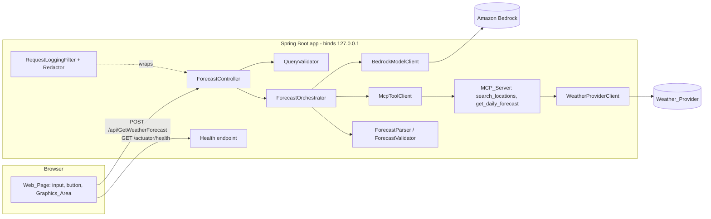
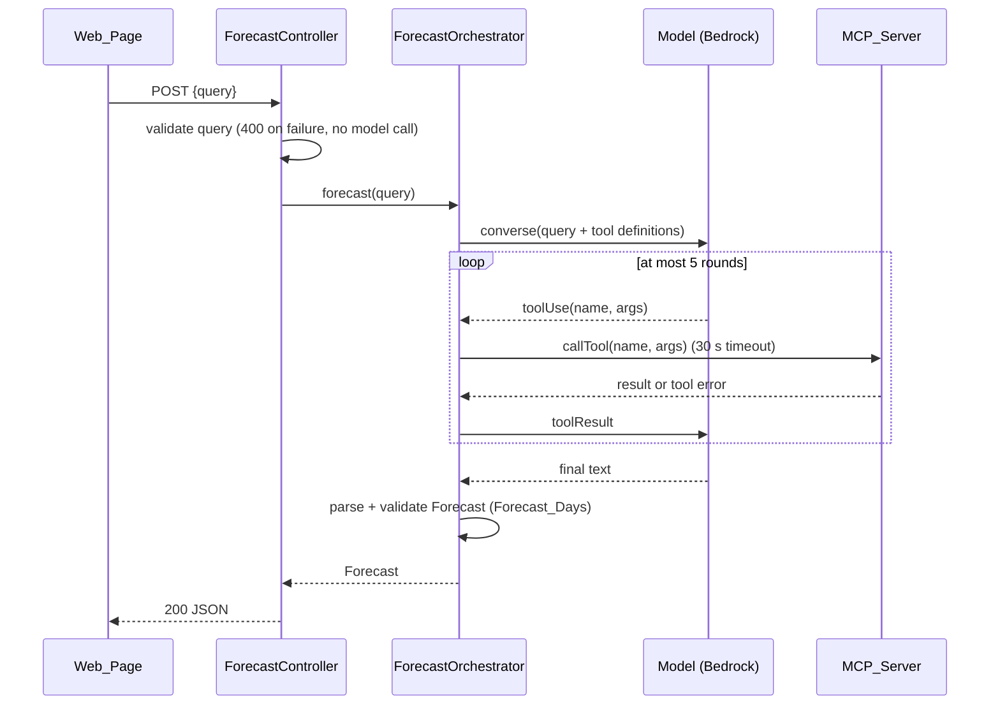

# Design Document

## Overview

AI WeatherMan is a Spring Boot (Java 21) application that turns a natural-language weather question into a Forecast_Days-day forecast (default 14) rendered as graphics. The flow is:

1. The browser sends the query to `POST /api/GetWeatherForecast`.
2. The API validates the query and hands it to a `ForecastOrchestrator`.
3. The orchestrator runs a tool-use loop against a GPT-backed model on Amazon Bedrock, using the Bedrock Converse API. Tool definitions come from the in-process MCP server.
4. The MCP server exposes two tools (`search_locations`, `get_daily_forecast`) that wrap a third-party weather provider.
5. The model's final answer is parsed into a `Forecast`, validated, and returned as JSON.
6. The page validates the response again and renders a card per day plus a temperature trend chart.

Key design decisions:

- **Configurable forecast length.** One setting, `weatherman.forecast.days` (default 14), drives the provider request, the tool, the system prompt and both validators.
- **Bedrock Converse API (AWS SDK for Java v2, `BedrockRuntimeClient`).** It gives one tool-use shape across Bedrock models, so the model id stays a configuration value (Req 4.1). Credentials come from `DefaultCredentialsProvider` (Req 4.7).
- **MCP server created inside the app process using the MCP Java SDK.** The Bedrock client talks to it through an MCP client over an in-memory transport. Nothing is exposed on the network, which supports the loopback-only default (Req 6.4). The server is started by a Spring lifecycle bean before the web server accepts traffic (Req 5.1, 5.2).
- **Pure functions at the edges, thin I/O shells.** Validation, parsing, mapping, redaction and the round-limit loop are pure or driven by injected interfaces. This keeps the logic property-testable without AWS or the weather provider.
- **Server validates, client validates again.** The page validates input and the response for fast feedback and defense in depth. The server never trusts the model output (Req 4.5).
- **Static front end** (plain HTML, CSS and ES modules, with inline SVG for the chart). It avoids a JS build step and a chart dependency. Rendering logic is split into a pure view-model builder and a thin DOM layer.
- **Weather provider.** The design treats the provider as an HTTP JSON API behind a `WeatherProviderClient` interface. Open-Meteo is the suggested default because it offers geocoding and daily forecasts, but any provider fits once its mapper is swapped. Base URL and API key come from configuration (Req 5.11).

## Architecture



### Request sequence



### Package layout

```
com.example.weatherman
  WeatherManApplication
  config/     WeatherManProperties, ConfigValidator, McpLifecycle
  web/        ForecastController, ApiExceptionHandler, RequestLoggingFilter
  forecast/   Forecast, DailyForecast, Location, ForecastValidator, ForecastParser
  llm/        ForecastOrchestrator, ModelClient, BedrockModelClient, ToolClient
  mcp/        WeatherMcpServer, ToolArgumentValidator, ProviderMapper, WeatherProviderClient
  logging/    Redactor
resources/static/  index.html, app.css, app.js, viewModel.js, validation.js, chart.js
```

### Error mapping

| Condition | HTTP | Requirement |
|---|---|---|
| Query missing, not a string, blank, over 500 chars | 400 | 3.4 |
| Body not valid JSON | 400 | 3.5 |
| Model resolves no location | 422 | 3.6 |
| Model output not a valid Forecast_Days-day Forecast | 502 | 4.5 |
| Round limit exceeded | 502 | 4.9 |
| Model unavailable (per 3.9) | 502 | 3.9 |
| Bedrock throttling, service error or 60 s timeout | 503 | 4.6 |
| Overall request exceeds 30 s | 504 | 3.9 |

Requirements 3.9 and 4.6 overlap on model unavailability (502 vs 503). The design resolves this as follows: a Bedrock throttling, service error or invocation timeout maps to 503 (Req 4.6, the more specific rule). 502 is used for invalid model output, round-limit exceeded, and any other model-side failure that is not a Bedrock service condition. The overall 30 s deadline maps to 504. A Bedrock invocation timeout is 60 s, but the overall deadline is 30 s, so in practice the 504 deadline fires first. The 60 s Bedrock timeout is still configured on the SDK client as a ceiling.

## Components and Interfaces

### ForecastController

```java
@RestController
class ForecastController {
    @PostMapping(value = "/api/GetWeatherForecast", consumes = "application/json", produces = "application/json")
    Forecast getWeatherForecast(@RequestBody JsonNode body);
}
```

The body is taken as a `JsonNode` so that "query missing" and "query not a string" produce the specific 400 message in Req 3.4. Malformed JSON is handled by `ApiExceptionHandler` (Req 3.5). The controller runs the orchestrator with a 30 s deadline (Req 3.8, 3.9).

### QueryValidator (pure)

```java
sealed interface QueryValidation { record Valid(String query) {} record Invalid(String rule, String message) {} }
QueryValidation validate(JsonNode body);
```

Rules in order: `missing`, `not_a_string`, `blank` (empty or whitespace only), `too_long` (over 500 characters). The JS twin `validateQuery(text)` in `validation.js` applies `blank` and `too_long` with the same predicate.

### ForecastOrchestrator

```java
interface ModelClient {
    ModelTurn converse(List<Message> messages, List<ToolDefinition> tools);  // throws ModelUnavailableException
}
interface ToolClient {
    List<ToolDefinition> listTools();
    ToolResult callTool(String name, JsonNode args);   // never throws; failures become ToolResult.error
}
sealed interface ModelTurn { record ToolUse(String id, String name, JsonNode args) implements ModelTurn {}
                             record Final(String text) implements ModelTurn {} }

class ForecastOrchestrator {
    static final int MAX_ROUNDS = 5;
    Forecast forecast(String query);
}
```

Algorithm:

1. Send the query and all tool definitions in the first invocation (Req 4.2).
2. On `ToolUse`: if `rounds == MAX_ROUNDS` throw `RoundLimitExceededException` (Req 4.9). Otherwise call the tool through `ToolClient`, append the result (or error result) to the conversation, and increment `rounds` (Req 4.3, 4.11).
3. On `Final`: pass the text to `ForecastParser` (Req 4.4).

A tool-use request is therefore honored in rounds 1 to 5 and a sixth request fails. Each tool exchange counts as one round whether it succeeded or failed, so the loop cannot exceed 5 tool calls.

The system prompt tells the model to resolve the place with `search_locations`, fetch data with `get_daily_forecast`, and answer with only a JSON object in the Forecast schema, or the JSON `{"error":"location_not_resolved"}` when no location can be resolved (mapped to 422, Req 3.6).

### BedrockModelClient

Implements `ModelClient` with `BedrockRuntimeClient.converse`. It reads `weatherman.bedrock.model-id` and `weatherman.bedrock.region` (Req 4.1), uses `DefaultCredentialsProvider` (Req 4.7), and sets a 60 s API call timeout. `ThrottlingException`, `ServiceUnavailableException`, other `BedrockRuntimeException` service errors and timeouts are translated to `ModelUnavailableException` (Req 4.6). Errors are logged with the Redactor applied (Req 6.6).

### ForecastParser and ForecastValidator (pure)

```java
Optional<Forecast> ForecastParser.parse(String modelText, int expectedDays);       // extracts the JSON object, deserializes, validates
List<String>       ForecastValidator.violations(Forecast f, int expectedDays);     // empty list means valid
```

A Forecast is valid when:

- the location name is non-empty and the latitude and longitude are in range;
- there are exactly `expectedDays` (Forecast_Days) daily entries;
- the dates are consecutive calendar days, each one day after the previous (Req 3.3);
- every entry has a date, high and low temperature (Celsius), a conditions summary, a precipitation probability between 0 and 100, and a wind speed.

The parser tolerates surrounding prose or a Markdown code fence by extracting the outermost JSON object. Anything that fails parsing or validation yields `Optional.empty()`, which the orchestrator turns into a 502, and no partial Forecast is ever returned (Req 4.5).

The requirement that the first date is "the current date at the Location" is enforced in the orchestrator, not in the pure validator. After parsing, it compares `days[0].date` to `LocalDate.now(ZoneId.of(forecast.location.timezone))`. A mismatch is treated as invalid model output. The Location carries an IANA `timezone` string, supplied by the weather tools.

### WeatherMcpServer

Created by `McpLifecycle` (a `SmartLifecycle` with an early phase). Startup failure aborts the context with an "MCP_Server failed to initialize" error (Req 5.2).

| Tool | Input schema | Output |
|---|---|---|
| `search_locations` | `{ "name": string (1-100 chars) }` | `{ "candidates": [ {displayName, latitude, longitude, timezone} ] }`, 0 to 14 entries |
| `get_daily_forecast` | `{ "latitude": number [-90,90], "longitude": number [-180,180] }` | `{ "days": [ ... Forecast_Days entries starting today ... ] }` |

Each tool carries a name, a description and a JSON input schema (Req 5.6).

Processing for every call:

1. `ToolArgumentValidator` validates arguments. Failure returns an MCP tool error naming the argument, and the provider is not called (Req 5.8).
2. `WeatherProviderClient` queries the provider with a 10 s timeout (Req 5.10). Unreachable, error status and timeout map to MCP tool errors with a reason (Req 5.9, 5.10).
3. `ProviderMapper` (pure) converts the provider payload into the tool result (Req 5.3, 5.4). An empty match is a successful empty list (Req 5.5).

The `ToolClient` implementation applies a 30 s per-call timeout and converts failures into error results (Req 4.11).

### Configuration

```java
@ConfigurationProperties("weatherman")
record WeatherManProperties(Bedrock bedrock, Provider provider, Forecast forecast) {
    record Bedrock(String modelId, String region) {}
    record Provider(String baseUrl, String apiKey) {}
    record Forecast(@DefaultValue("14") int days) {}
}
```

Property names are fixed by environment variables: `WEATHERMAN_BEDROCK_MODEL_ID`, `WEATHERMAN_BEDROCK_REGION`, `WEATHERMAN_PROVIDER_BASE_URL`, `WEATHERMAN_PROVIDER_API_KEY`, `WEATHERMAN_FORECAST_DAYS`. The forecast length (`weatherman.forecast.days`, default 14) is checked at startup and must be an integer from 1 to 14 (the app limit; Open-Meteo itself allows up to 16); otherwise startup fails with an error naming `WEATHERMAN_FORECAST_DAYS` (Req 4.12). The value drives the provider request (`forecast_days=<configured>`), the `get_daily_forecast` tool description, the system prompt and both validators. The page reads it from `GET /api/config`, which returns `{"forecastDays": 14}` (Req 2.8). `application.yml` holds only non-secret defaults and `server.address: 127.0.0.1` (Req 6.4). An operator overrides the bind address with `SERVER_ADDRESS`.

`ConfigValidator` (pure) takes a map of required keys to values and returns the keys that are null or blank. Startup failure runs as an `ApplicationRunner`-independent check, a `@PostConstruct` in a bean created before the web server, which throws `ConfigurationException` listing the missing key names only (Req 4.10, 5.12, 6.2). Spring Boot then exits non-zero and logs the message. Secret values never appear in the message.

Security notes:

- Secrets come from environment variables or an external secrets store, and none are committed (Req 6.1). `.gitignore` excludes `.env*` files.
- The default bind of 127.0.0.1 means nothing is reachable off-host unless the operator opts in. The API has no authentication, so the design recommends putting an authenticating proxy in front of it if the bind address is widened. This is a documented operator responsibility, not something the app can enforce.
- Cross-site requests are limited by serving the page and the API from the same origin, with no CORS configuration enabled.

### Redactor (pure)

```java
String Redactor.redact(String text, Collection<String> secrets);
```

It replaces every occurrence of each non-empty secret with `***`. It is applied to every log message and error response body produced by the exception handler, and the AWS credential values from the resolved credentials are included in the secrets set at startup (Req 6.3).

### Logging and health

- `RequestLoggingFilter` generates a request id (also placed in the MDC), and on completion writes one entry with request id, status and duration rounded to whole milliseconds (Req 6.5). It applies only to `/api/GetWeatherForecast`.
- Bedrock and MCP failures log one ERROR entry with request id, dependency name (`Bedrock` or the tool name) and a redacted reason (Req 6.6).
- Health: Spring Boot Actuator `/actuator/health`, exposing only the `health` endpoint, no auth, with a simple liveness indicator that makes no Bedrock or MCP calls (Req 6.7).

### Front end

`index.html` contains the Graphics_Area (`<section id="graphics">`), a text input (`maxlength` is intentionally not set, so the 500 character message can be shown), the Submit_Button, a status region (`aria-live="polite"`) for validation, loading and error messages, and labels for accessibility. The chart is SVG with a text alternative (a visually hidden table of the same data).

Modules:

- `validation.js`: `validateQuery(text)` returns `{ok:true}` or `{ok:false, message}` (Req 1.3, 1.4); `validateForecast(f, dayCount)` checks `dayCount` entries (taken from `GET /api/config`) and all fields (Req 2.7).
- `viewModel.js`: `buildViewModel(forecast)` returns `{ locationLabel, days[], chart }`. It sorts days ascending by date, truncates the location name to 100 characters, formats each day with date, icon key, high and low with unit, precipitation percent, and wind with unit, and builds chart series (Req 2.1 to 2.4).
- `chart.js`: renders the view model's chart to SVG with dates on the x axis and temperature on the y axis.
- `app.js`: wiring. On submit it validates, sets the pending state (loading indicator, disabled button, ignore further submits including Enter), calls the API with an `AbortController` timeout, validates the response, and then replaces the Graphics_Area content entirely from the new view model (Req 2.5). On any error it shows a message and leaves the existing content untouched (Req 2.6, 2.7). Pending state is always cleared in a `finally` block, after the response, an error or a 30 s client timeout (Req 1.6).

The page timeout is 30 s. Req 2.6 asks for an error after 10 s without a response, while Req 1.6 and 3.8 allow the API up to 30 s. The design reconciles this by showing a "still working" notice at 10 s and by treating the 30 s elapse as the failure point that hides the loading indicator. The 10 s requirement for an error display is satisfied for responses that arrive with an error status. This tension is a known requirements inconsistency and is flagged for the user.

## Data Models

### Forecast JSON schema

```json
{
  "location": { "name": "Seattle, Washington, US", "latitude": 47.6062, "longitude": -122.3321, "timezone": "America/Los_Angeles" },
  "days": [
    {
      "date": "2025-01-15",
      "highC": 8.4,
      "lowC": 2.1,
      "conditions": "Light rain",
      "conditionCode": "rain",
      "precipitationProbabilityPct": 70,
      "windSpeedKmh": 14.0
    }
  ]
}
```

`days` has exactly Forecast_Days entries. Units are fixed (Celsius, km/h) and appear in the field names; the UI appends the unit text (`°C`, `km/h`).

### Java types

```java
record Location(String name, double latitude, double longitude, String timezone) {}
record DailyForecast(LocalDate date, double highC, double lowC, String conditions,
                     String conditionCode, int precipitationProbabilityPct, double windSpeedKmh) {}
record Forecast(Location location, List<DailyForecast> days) {}
record ErrorResponse(String error, String message) {}   // error is a stable code such as "invalid_query"
```

Jackson is configured to write dates as ISO-8601 strings, to fail on unknown properties for model output parsing, and to use `BigDecimal`-free doubles. Round-trip equality relies on record `equals`. Doubles are finite; `NaN` and infinity are rejected by the validator.

### Request

```json
{ "query": "What's the weather like in Seattle this week?" }
```

### MCP tool results

Both tools return a single JSON text content item. Errors use the MCP `isError: true` flag with a message such as `invalid argument 'latitude': must be between -90 and 90`.

### View model (front end)

```js
{ locationLabel: string /* <= 100 chars */,
  days: [{ dateLabel, iconKey, highLabel, lowLabel, precipLabel, windLabel }],   // Forecast_Days (default 14), ascending
  chart: { dates: string[Forecast_Days], highs: number[Forecast_Days], lows: number[Forecast_Days] } }
```

## Correctness Properties

*A property is a characteristic or behavior that should hold true across all valid executions of a system-essentially, a formal statement about what the system should do. Properties serve as the bridge between human-readable specifications and machine-verifiable correctness guarantees.*

After the prework, the properties were consolidated: the client and server query checks became one property, the forecast checks for dates, count and fields became one validator property, the four view-model rendering criteria became one property, and the three configuration criteria became one property.

### Property 1: Query validation classification

*For any* input value, the query validator accepts it if and only if it is a string of 1 to 500 characters containing at least one non-whitespace character. Every rejected input yields a specific rule name (`missing`, `not_a_string`, `blank` or `too_long`), and a rejected input never results in a Model invocation. The client-side and server-side predicates agree on all strings.

**Validates: Requirements 1.2, 1.3, 1.4, 3.4**

### Property 2: Forecast JSON round trip

*For any* valid Forecast, serializing it to JSON and deserializing the result produces a Forecast equal to the original.

**Validates: Requirements 3.7**

### Property 3: Forecast validity classification

*For any* Forecast value, the validator reports it valid if and only if it has exactly Forecast_Days daily entries, the dates are consecutive calendar days in ascending order, and every entry has all required fields with the precipitation probability between 0 and 100 and finite numeric values. A forecast with a changed count, a gap or duplicate in dates, or a removed field is reported invalid.

**Validates: Requirements 2.7, 3.3**

### Property 4: Model output parsing

*For any* valid Forecast, embedding its JSON in arbitrary surrounding text (including a Markdown fence) and parsing yields the original Forecast. *For any* text that does not contain a valid Forecast_Days-day Forecast, parsing yields no Forecast, so no partial result is produced.

**Validates: Requirements 4.4, 4.5**

### Property 5: View model fidelity

*For any* valid Forecast (including days supplied in shuffled order and location names of any length), the view model contains exactly Forecast_Days day entries in ascending date order, each showing the date, icon, high and low with units, precipitation percentage and wind speed with unit. The chart series contain the Forecast_Days dates, highs and lows of the Forecast in the same order, and the location label is the name truncated to at most 100 characters. The view model depends only on the Forecast supplied, so rendering a second Forecast after a first leaves no data from the first.

**Validates: Requirements 2.1, 2.2, 2.3, 2.4, 2.5**

### Property 6: Orchestrator round limit

*For any* scripted sequence of model turns and tool outcomes (each tool call succeeding, failing or timing out), the orchestrator makes at most 5 tool calls. If the model requests a tool call after the 5th round has completed, the orchestrator fails with a round-limit error and makes no further model or tool invocations. If the model finishes within 5 rounds, every tool failure was returned to the model as an error result and the run continued.

**Validates: Requirements 4.3, 4.8, 4.9, 4.11**

### Property 7: Required configuration check

*For any* assignment of values to the four required settings, the configuration validator reports exactly the set of settings whose value is null or blank. The resulting message names each reported key and contains no setting value.

**Validates: Requirements 4.10, 5.12, 6.2**

### Property 8: Secret redaction

*For any* text and any non-empty set of secret strings, the redacted text contains none of the secrets, and text that contains no secret is returned unchanged.

**Validates: Requirements 6.3**

### Property 9: Tool argument validation

*For any* arguments to `get_daily_forecast` or `search_locations`, the validator accepts them if and only if they match the tool's schema (latitude in [-90, 90], longitude in [-180, 180], place name of 1 to 100 characters, correct types). Rejected arguments produce an error that names the offending argument, and the provider client is not called.

**Validates: Requirements 5.8**

### Property 10: Provider mapping

*For any* provider payload with at least Forecast_Days daily entries, the forecast mapper (`mapForecast(body, dayCount)`) returns exactly Forecast_Days entries in date order starting from the first provider date. *For any* provider list of location matches, the mapper returns at most 14 candidates, and an empty list yields an empty successful result.

**Validates: Requirements 5.3, 5.4, 5.5**

## Error Handling

- **Validation errors (400).** `ApiExceptionHandler` maps `QueryValidation.Invalid` and `HttpMessageNotReadableException` to `ErrorResponse` with codes `invalid_query` and `malformed_body`.
- **Unresolved location (422).** The model returns the `location_not_resolved` marker, or `search_locations` returned nothing and the model gives up. The message asks the user to provide a specific location.
- **Invalid model output (502).** Parse or validation failure, or a first date that is not today at the Location. The response says the model output was invalid. No partial data is returned.
- **Round limit (502).** `RoundLimitExceededException`.
- **Bedrock unavailable (503).** Throttling, service error or 60 s timeout.
- **Deadline (504).** The controller enforces a 30 s overall deadline using a `CompletableFuture` with a timeout, cancelling in-flight work.
- **MCP tool failures.** Never surface directly. They are returned to the model as tool errors and count as a round, so the model may retry or give up (Req 4.11).
- **Startup failures.** Missing configuration or MCP creation failure throw during context startup, which logs the error and exits non-zero. Messages name keys only.
- **Logging.** All error logs pass through the Redactor. Stack traces are logged but never included in responses.
- **Front end.** Errors produce a message in the status region using the API's `message` field when present, and the previous Forecast stays on screen. A non-JSON or network failure shows a generic "could not reach the service" message.

## Testing Strategy

Property-based testing applies to the pure logic: validation, parsing, serialization, mapping, redaction, configuration checks and the orchestrator loop (driven by fake `ModelClient` and `ToolClient`). It does not apply to Spring wiring, DOM rendering, Bedrock or provider I/O, or startup ordering, which use example, smoke and integration tests.

### Property-based tests

- **Java:** jqwik. **JavaScript:** fast-check (run with Node's built-in test runner or Vitest).
- Each property is implemented as a single property-based test, configured for at least 100 iterations (`@Property(tries = 100)`, `fc.assert(..., { numRuns: 100 })`).
- Each test carries a tag comment in the form `Feature: ai-weatherman, Property N: <property text>`.

| Property | Library | Under test |
|---|---|---|
| 1 | jqwik and fast-check | `QueryValidator`, `validateQuery` |
| 2 | jqwik | Jackson `Forecast` serialization |
| 3 | jqwik and fast-check | `ForecastValidator`, `validateForecast` |
| 4 | jqwik | `ForecastParser` |
| 5 | fast-check | `buildViewModel` |
| 6 | jqwik | `ForecastOrchestrator` with fakes |
| 7 | jqwik | `ConfigValidator` |
| 8 | jqwik | `Redactor` |
| 9 | jqwik | `ToolArgumentValidator` |
| 10 | jqwik | `ProviderMapper` |

Generators produce valid Forecasts (Forecast_Days consecutive dates, in-range values, Unicode location names of 1 to 300 characters) and targeted mutations of them (dropped day, extra day, date gap, missing field, probability out of range) for Properties 3 to 5.

### Unit and example tests

- Controller tests with `MockMvc` and a mocked orchestrator: 200 on success (Req 3.1, 3.2), 400 for malformed JSON (3.5), 422 (3.6), 502 and 503 mappings (3.9, 4.5, 4.6, 4.9), and a 504 using a slow fake (3.8, 3.9).
- Orchestrator: first Bedrock call includes the query and all tool definitions (Req 4.2).
- MCP server: valid call reaches a mocked provider (Req 5.7), provider 500 and unreachable map to tool errors (5.9), a slow provider times out at 10 s (5.10), and the tool list has names, descriptions and schemas (5.6). The provider is mocked with WireMock.
- Logging: request log entry has id, status and whole-millisecond duration (Req 6.5); error log entries have the dependency and no secrets (6.6).
- Health endpoint returns healthy without credentials and without calling Bedrock or MCP (Req 6.7).
- Front end (jsdom): pending state disables the button and ignores Enter and repeated clicks (Req 1.5), state clears after response, error and 30 s (1.6), Enter submits (1.7), validation messages keep input contents (1.3, 1.4), errors and incomplete forecasts retain the previous graphics (2.6, 2.7).

### Smoke and integration tests

- Context startup with missing settings fails with the key named (Req 4.10, 5.12, 6.2), and the MCP server exists before the web server accepts requests (5.1, 5.2).
- Default `server.address` is `127.0.0.1` (Req 6.4). Credentials use the default provider chain (Req 4.7). Settings are read from configuration (Req 4.1, 5.11).
- Page is served from `/` (Req 1.1). The 2 second serving time and 1 second render time are checked by a single timed example each, not by property tests.
- An optional, opt-in end-to-end test against real Bedrock and the real provider runs only when credentials are present in the environment. It is excluded from the default build.
